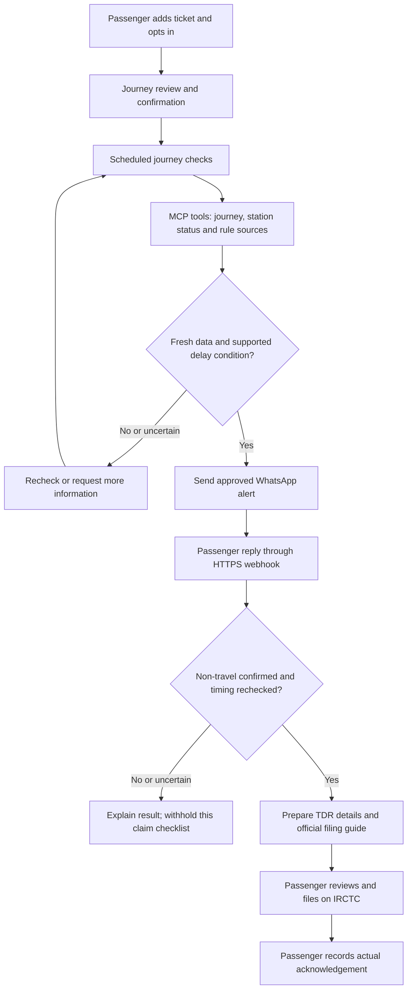

# 🚆 RailRefund

### A late train should not become a missed refund deadline.

RailRefund is a proposed MCP-powered assistant that helps Indian railway passengers recognise a possible refund claim, understand its deadline and prepare to file through the official channel. It brings journey details, station-specific train status and refund rules into a simple WhatsApp conversation.

**Know the rule. Get the alert. Take the next step.**

> **Project status:** Concept and presentation prototype. The animated presentation, simulated WhatsApp demo and editable pitch deck are available. The backend, MCP server, live train-status connection and live WhatsApp messaging are planned. The demo does not submit claims or process refunds.

## Why RailRefund?

Imagine waiting four hours for a train, deciding not to travel, and then discovering that a refund filing deadline has passed.

Passengers need to connect several pieces of information while their plans are changing: their booking, the train's status at their boarding station, the applicable rule and the official filing process. RailRefund aims to turn that information into a clear, timely action.

For the delayed-train e-ticket scenario, the published rule concerns a delay of **more than three hours**, a journey not undertaken because of that delay, and an online TDR filed **before actual departure**. The concerned Railway decides the claim. RailRefund would identify a **possible claim**, not approve a refund. [Official IRCTC refund rules](https://contents.irctc.co.in/en/RefundCancellationRules.pdf).

**TDR** means **Ticket Deposit Receipt**.

## Who it helps

| Passenger | Intended benefit |
| --- | --- |
| Students and occasional travellers | Understand the next step without first learning the entire refund process. |
| Families sharing a booking | Review the affected passengers and make an explicit travel decision. |
| People managing several journeys | Keep journey details and reminders together; planned for a later version. |
| Passengers with onward connections | Receive connection-risk guidance, with any refund assessment handled under its own applicable rule. |

## Explore the concept

- [Animated presentation](https://railrefund-pitch-7c9e4a.active-bloom-7100.chatgpt.site)
- [Offline HTML presentation](output/RailRefund_Animated_Presentation.html)
- [Simulated WhatsApp demo video](output/RailRefund_WhatsApp_Demo.mp4)
- [Editable PowerPoint pitch](output/RailRefund_wHACKiest_2026_Editable.pptx)

The presentation and video illustrate the intended experience. They are not evidence of a live Meta or railway integration.

### A passenger's journey

The demo follows **Asha**, a fictional passenger with a self-booked IRCTC e-ticket. Everyone on the sample booking decides not to travel; mixed travel decisions are outside this first demo.

| Step | What happens |
| --- | --- |
| 1. Add the journey | Asha confirms the ticket, boarding station and journey date, then opts in to alerts. |
| 2. Detect the disruption | A simulated update shows that the train has still not departed at 12:15, after an 08:00 scheduled departure. |
| 3. Explain the action | RailRefund shows the relevant rule and an urgent message to act before actual departure. |
| 4. Confirm the decision | Asha explicitly confirms that everyone on the booking will not travel. |
| 5. Prepare the details | RailRefund assembles the booking details, passenger list, suggested reason and filing checklist for review. |
| 6. File officially | The booking-account holder opens IRCTC and submits the claim. |

The filing guide directs users through **My Account → My Transactions → File TDR**. RailRefund would help prepare the information; the user completes and confirms submission on IRCTC. [Official TDR filing guide](https://contents.irctc.co.in/en/FileTDR.pdf).

### Example WhatsApp conversation

> **RailRefund:** Your train is over three hours late at your boarding station. If you will not travel, you may qualify under the delayed-train rule. File promptly, before the train actually departs. Will everyone on this booking remain untravelled?
>
> **Passenger:** Yes, none of us will travel.
>
> **RailRefund:** Review your booking details, passenger list and TDR reason. Here is your checklist and the official filing guide. Submit through your IRCTC account and save the acknowledgement.

*Illustrative message copy. Live outbound templates would require Meta approval where applicable.*

## Planned features

- **Ticket review:** Capture journey details and require passenger confirmation before monitoring.
- **Station-specific monitoring:** Check the passenger's boarding station and display the status source and update time.
- **Rule-based guidance:** Evaluate supported scenarios using versioned rules and deterministic code.
- **WhatsApp alerts:** Explain the possible claim and next action in a familiar interface.
- **TDR preparation:** Assemble a checklist for the passenger to review and use on IRCTC.
- **Acknowledgement tracking:** Let the passenger record the real filing acknowledgement after submission.
- **Explainable results:** Show why a case was flagged and link to the supporting rule.

## Proposed architecture

### Why MCP?

The **Model Context Protocol** provides a standard way for AI applications to access external tools and data. RailRefund would use it to connect journey information, train-status adapters and sourced rules through a consistent interface. [MCP introduction](https://modelcontextprotocol.io/docs/getting-started/intro).

| Proposed tool | Responsibility |
| --- | --- |
| `get_journey` | Retrieve passenger-confirmed booking details. |
| `get_train_status` | Return boarding-station status, source and timestamp. |
| `get_refund_rule` | Retrieve a supported rule, its version and official source. |
| `evaluate_case` | Run code-based condition and timing checks. |
| `prepare_tdr_checklist` | Assemble details for passenger review. |
| `send_alert` | Request a message through the consent and messaging-policy checks. |

These are proposed interfaces, not implemented endpoints. The scheduled checker is responsible for proactive monitoring. MCP connects the tools; the WhatsApp API delivers messages. A language model may explain a result, while code determines conditions and timing.

## WhatsApp API integration plan

The planned messaging channel is **Meta's WhatsApp Business Platform Cloud API**. Outbound messages go through the messaging API, while an HTTPS webhook receives passenger replies and message-status events. [Meta developer documentation](https://developers.facebook.com/documentation/business-messaging/whatsapp/overview/).

1. **Set up the business messaging account.** Configure a WhatsApp Business account, a sending number and server-side credentials.
2. **Collect explicit opt-in.** Associate consent with the passenger and journey, and provide a way to stop alerts.
3. **Prepare alert templates.** Submit the required templates for approval before using them to initiate conversations.
4. **Send a relevant alert.** A fresh rule check triggers the message, including the journey context and required action.
5. **Handle the reply.** Verify webhook requests, process events without duplication and record the passenger's explicit travel decision.
6. **Recheck and guide.** Revalidate timing before returning a checklist and official filing instructions.
7. **Track delivery separately.** A delivered message is not proof that a passenger filed a TDR or received a refund.

WhatsApp requires recipient opt-in and respect for opt-outs. Business-initiated conversations use approved templates; outside the 24-hour customer-service window, messages must also use approved templates. Automated support needs a clear escalation route. [WhatsApp Business Messaging Policy](https://business.whatsapp.com/policy).

The initial demo uses simulated messages. Live messaging depends on account configuration, template approval and working credentials.

## Proposed technology stack

| Layer | Technology | Purpose |
| --- | --- | --- |
| Passenger interface | Next.js / TypeScript | Ticket review, consent and case guidance. |
| Backend | Python / FastAPI | Workflow coordination and webhook handling. |
| Tool integration | MCP server | Consistent access to journey, status and rule tools. |
| Rules | Versioned JSON + deterministic code | Auditable conditions and deadline checks. |
| Prototype storage | SQLite | Journeys, consent, status snapshots and acknowledgement records. |
| Messaging | WhatsApp Cloud API | Alerts and passenger replies. |
| Monitoring | Background scheduler | Repeat checks and avoid duplicate alerts. |
| Train data | Simulated adapter initially | Replace with an authorised, reliable feed after access is validated. |
| Optional AI | Language model | Plain-language explanations and assisted extraction with user review. |

This is the planned stack. The current presentation is static HTML/CSS/JavaScript; the application services above have not been implemented in this workspace.

## MVP scope and roadmap

- [x] Define the passenger problem and initial demo scenario.
- [x] Create an animated presentation and simulated WhatsApp demo.
- [x] Prepare an editable pitch deck with architecture diagrams.
- [ ] Build ticket review and consent screens.
- [ ] Implement one delayed-train rule with synthetic fixtures.
- [ ] Add the MCP tools and scheduled monitoring.
- [ ] Build the checklist and official filing handoff.
- [ ] Connect and test WhatsApp messaging with authorised test recipients.
- [ ] Validate a live train-data source and status freshness handling.
- [ ] Run a small opt-in usability pilot.
- [ ] Explore consented email import, calendar reminders and separate linked-journey rules.

The first MVP targets one self-booked e-ticket scenario. Other ticket channels, partially travelled bookings and connecting journeys need separate handling. Live data access, railway partnerships, user traction and refund outcomes have not been established.

## Getting started with the current prototype

1. Download or clone this repository, including the `output` folder.
2. Open `output/RailRefund_Animated_Presentation.html` in a browser.
3. Open the demo video or editable PowerPoint using the links above.

No API keys or backend installation are needed to view the presentation. Application setup commands will be added when runnable application code is available.

## Planned validation

| Scenario | Expected behaviour |
| --- | --- |
| Exactly three hours late | Do not trigger the more-than-three-hour condition. |
| More than three hours late, before departure | Ask for the travel decision and evaluate the supported case. |
| Stale, missing or conflicting station data | Show uncertainty and request a fresh check. |
| Departure changes earlier than estimated | Recheck promptly; never treat an estimate as a guaranteed cutoff. |
| Train has already departed | Do not present this filing opportunity as still open. |
| Someone on the sample booking will travel | Stop this simplified non-travel workflow and require separate assessment. |
| Duplicate webhook event | Avoid duplicate state changes and repeated alerts. |
| Passenger opts out | Stop further WhatsApp alerts. |

These are acceptance criteria to implement, not a claim that automated tests already pass.

## Privacy and passenger control

- Use synthetic bookings and messages in public demos.
- Collect only the details needed for the journey and the chosen notification channel.
- Mask PNRs and phone numbers in logs and presentation screens.
- Keep messaging credentials on the server and out of the repository.
- Provide consent withdrawal and a deletion path.
- Keep IRCTC login, OTPs, payment credentials and final submission with the passenger.

RailRefund is an independent project concept, with no claimed affiliation with Indian Railways, IRCTC or Meta. It offers assistance with understanding and preparing a possible claim; official systems determine filing status and refund decisions.

## Contributing

Useful contributions include accessible passenger interfaces, sourced rule updates, synthetic edge-case fixtures, reliable status adapters and clear multilingual explanations. Describe the passenger scenario, expected behaviour and supporting source when proposing a change. Do not include real booking details or API secrets in issues or pull requests.

## License

A repository license has not yet been selected. The project owner should add a `LICENSE` file before inviting reuse under specific terms. Third-party template artwork and logos retain their respective owners' rights.

<!-- Add your team name and GitHub profile links here when ready. -->

*Rule and integration references reviewed on 24 November 2026. Recheck official sources before implementing or using a live workflow.*
